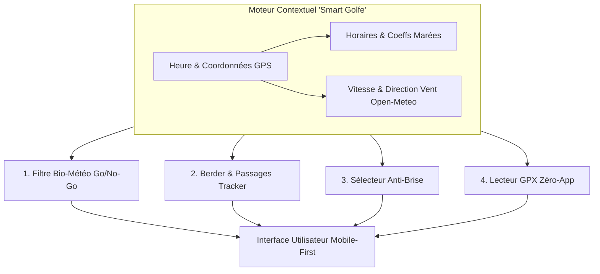
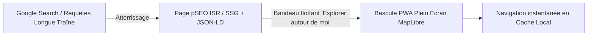
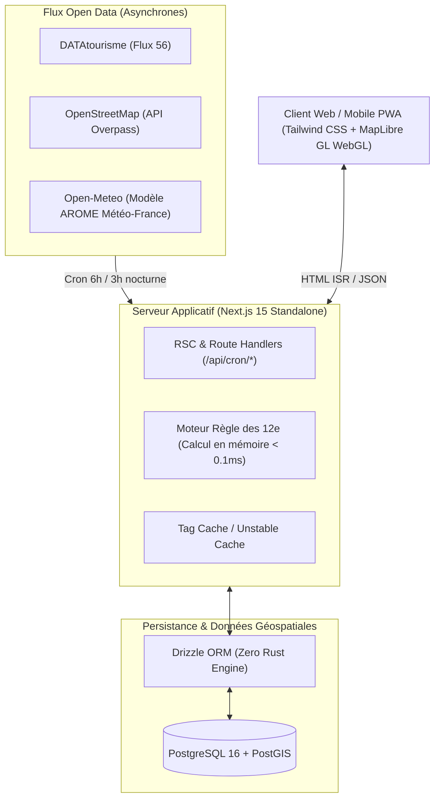
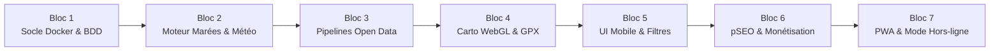

# Cahier des Charges Fonctionnel & Technique (PRD)
## Le Copilote Contextuel du Golfe du Morbihan

> **Version :** 1.0 — Document de cadrage consolidé  
> **Statut :** Prêt pour développement  
> **Cible :** Visiteurs, randonneurs, plaisanciers, résidents & professionnels du Morbihan Sud  
> **Objectif budgétaire :** 0 € au lancement (Phase 1 Vercel Hobby + Supabase/Neon) vers VPS souverain Docker/Coolify (Phase 2)

---

## Sommaire

1. [Vision & Analyse Stratégique](#1-vision--analyse-stratégique)
   - [Le diagnostic des plateformes actuelles](#le-diagnostic-des-plateformes-actuelles)
   - [Le positionnement gagnant : "Right Here, Right Now"](#le-positionnement-gagnant--right-here-right-now)
   - [Les 4 fonctionnalités différenciantes ("Killer Features")](#les-4-fonctionnalités-différenciantes-killer-features)
   - [Stratégie d'acquisition SEO : L'architecture "Cheval de Troie"](#stratégie-dacquisition-seo--larchitecture-cheval-de-troie)
2. [Stratégie de Monétisation (Solo & Zéro Budget)](#2-stratégie-de-monétisation-solo--zéro-budget)
   - [Matrice d'évaluation des modèles de revenus](#matrice-dévaluation-des-modèles-de-revenus)
   - [Déploiement en deux phases](#déploiement-en-deux-phases)
3. [Architecture Technique & Stratégie "Zéro Lock-in"](#3-architecture-technique--stratégie-zéro-lock-in)
   - [La Stack "Souveraine & Portable"](#la-stack-souveraine--portable)
   - [Flux de données & Caching multi-niveaux](#flux-de-données--caching-multi-niveaux)
   - [Moteur mathématique des marées (Règle des Douzièmes)](#moteur-mathématique-des-marées-règle-des-douzièmes)
4. [Spécifications Fonctionnelles & Ergonomie](#4-spécifications-fonctionnelles--ergonomie)
   - [Arborescence Next.js (App Router)](#arborescence-nextjs-app-router)
   - [Parcours et écrans clés](#parcours-et-écrans-clés)
   - [Matrice des filtres contextuels](#matrice-des-filtres-contextuels)
5. [Modèle de Données (Drizzle ORM & TypeScript)](#5-modèle-de-données-drizzle-orm--typescript)
   - [Types métier & Enums](#types-métier--enums)
   - [Schéma relationnel & spatial](#schéma-relationnel--spatial)
6. [Plan de Développement Modulaire (7 Blocs)](#6-plan-de-développement-modulaire-7-blocs)
7. [Matrice des Risques & Réponses](#7-matrice-des-risques--réponses)

---

## 1. Vision & Analyse Stratégique

### Le diagnostic des plateformes actuelles

Les portails institutionnels (Offices de Tourisme intercommunaux, comités départementaux et régionaux) souffrent d'une inertie structurelle : **ils sont organisés selon une gouvernance administrative et de subventions, et non par rapport aux usages réels du terrain**.

| Symptôme institutionnel | Conséquence utilisateur |
|---|---|
| **Arborescences en silos administratifs** (*Dormir / Manger / Bouger*) | Navigation lourde, friction cognitive pour répondre à un besoin immédiat. |
| **Cartographie lourde & lente** | Rechargement complet de page, pas d'expérience fluide sur smartphone 4G. |
| **Ressources en PDF non responsives** | Horaires de marées et guides de passages illisibles sur écran de smartphone. |
| **Absence totale de conscience contextuelle** | Recommandation d'une plage de vase à marée basse ou d'un passage submersible recouvert par 2 mètres d'eau de mer. |

---

### Le positionnement gagnant : "Right Here, Right Now"

Dans le Golfe du Morbihan, le paysage se métamorphose toutes les 6 heures. La marée, la hauteur d'eau, le marnage et l'orientation du vent conditionnent plus de **80 % de la qualité de l'expérience**.

> [!IMPORTANT]
> **La Promesse Produit :** Ne pas être une énième encyclopédie froide, mais un **moteur de décision temps réel**. L'utilisateur ouvre la webapp à 14h15 à Arradon, Baden ou Auray : l'interface lui indique instantanément ce qui est praticable, abrité, baignable et pertinent à cet instant précis.

---

### Les 4 fonctionnalités différenciantes ("Killer Features")



#### 1. Le Filtre Bio-Météorologique "Go / No-Go" (Temps Réel)
* **Fonctionnement :** Croisement algorithmique des fiches lieux avec l'état de marée instantané (ports de référence : Port-Navalo et Vannes) et les conditions météorologiques.
* **Exemple concret :**
  - Les plages du fond de golfe (*Toulindac*, *Conleau*, *Penboch*) affichent un statut **"Baignade idéale actuellement"** uniquement à \(PM \pm 2\text{h}30\).
  - À marée basse, elles basculent automatiquement en statut *"Pêche à pied / Estran vaseux"*, tandis que les plages océaniques (*Erdeven*, *Suscinio*, *Houat*) sont mises en avant dans les flux prioritaires.

#### 2. Le "Berder & Passages Tracker" (Alerte Submersion)
* **Fonctionnement :** Module prédictif temps réel en en-tête d'application dédié aux passages submersibles mythiques (chaussée submersible de l'Île de Berder à Larmor-Baden, passage de l'Île Tascon à Saint-Armel).
* **Affichage dynamique :** Calcul de la courbe de marée locale avec affichage d'un compte à rebours précis :
  > *"Passage de Berder : Praticable au sec pendant encore 1h42 (Attention : courant de la Jument fort au flot)"*.

#### 3. Le Sélecteur de Plage "Anti-Brise" (Protection Thermique & Houle)
* **Fonctionnement :** Chaque crique et plage répertoriée possède un vecteur d'orientation cardinale (ex : Sud-Est pour la plage des 7 Îles, Ouest pour la Côte Sauvage de Quiberon).
* **Rendu :** L'application interroge Open-Meteo et applique un badge contextuel **"À l'abri du vent aujourd'hui"** sur les criques protégées du vent thermique d'après-midi.

#### 4. Le Lecteur GPX "Zéro-App" (Profil Altimétrique & Points d'Intérêt)
* **Fonctionnement :** Sans installer d'application tierce, un clic sur un tronçon (GR34, tour de l'Île-aux-Moines, presqu'île de Rhuys) déploie la trace plein écran.
* **Intégrations :**
  - Suivi GPS via l'API du navigateur (`navigator.geolocation.watchPosition`).
  - Graphique d'altitude interactif synchronisé avec le marqueur sur la carte.
  - Enrichissement par OpenStreetMap : cales de mise à l'eau, fontaines d'eau potable, toilettes publiques, boulangeries ouvertes.

---

### Stratégie d'Acquisition SEO : L'Architecture "Cheval de Troie"

Une Single Page Application (SPA) fermée ne génère aucun trafic organique. Un simple blog statique déçoit l'utilisateur mobile. L'architecture hybride Next.js 15 résout cette dualité :



1. **Génération Programmatique (pSEO en SSG/ISR) :**
   - Génération de centaines d'URLs ciblées combinant `[Intention] + [Catégorie] + [Commune/Île] + [Contrainte]` :
     - `/explorer/baignade-maree-basse-arradon`
     - `/explorer/randonnee-ombre-saint-goustan-auray`
     - `/explorer/que-faire-pluie-vannes`
     - `/passages/horaires-ile-de-berder-aujourd-hui`
   - Données structurées **JSON-LD** (`TouristAttraction`, `Event`, `FAQPage`) réhydratées avec les données du jour sans surcoût serveur.
2. **Le Pivot UX (Transition vers la PWA) :**
   - L'internaute qui arrive depuis Google dispose immédiatement d'une réponse claire en HTML statique.
   - Un bandeau contextuel flottant (*"Voir sur la carte interactive autour de moi"*) déclenche le composant cartographique WebGL sans rechargement de page.

---

## 2. Stratégie de Monétisation (Solo & Zéro Budget)

### Matrice d'évaluation des modèles de revenus

| Modèle de Revenus | Potentiel Financier | Impact UX / SEO | Charge de gestion (Solo) | Verdict stratégique |
|---|---|---|---|---|
| **Bannières / Ads (AdSense, Ezoic)** | Faible (< 3 € RPM) | **Désastreux** (Dégradation CLS, lenteur 4G) | Nulle | ❌ **À proscrire.** Ruine la valeur de vitesse et de netteté. |
| **Pass Freemium / Micropaiement (2-4 €)** | Moyen | Neutre | Faible | ⚠️ **Complémentaire.** Réservé à l'export hors-ligne complet (Packs GPX). |
| **Sponsoring Local Natif ("Coups de cœur")** | **Très élevé** (150 € à 400 € / saison / partenaire) | **Positif** (Recommandation contextualisée) | Faible (Campagne automatisée) | ✅ **Pilier N°1.** Répond au besoin de visibilité directe des commerçants sans commission d'intermédiaire. |
| **Affiliation Ciblée (Loisirs & Transports)** | **Élevé** (8 à 12 % sur réservations) | **Fluide** (Call-To-Action direct et utile) | Quasi nulle | ✅ **Pilier N°2.** Revenu passif automatisé sur traversées insulaires et locations nautiques. |

### Déploiement en deux phases

#### Phase 1 : Mois 1 à 6 — 100 % Passif
* **Affiliation contextuelle :** Liens profonds (Manawa, GetYourGuide, compagnies maritimes de la baie, loueurs de kayaks) conditionnés par la météo : le bouton *"Louer un kayak à Saint-Philibert"* ne s'affiche que si la météo des 3 jours à venir est favorable.
* **Micro-produit numérique "Pack Rando & Nautisme Hors-Ligne" (3,90 €) :** Téléchargement instantané via Stripe Payment Links des 40 meilleurs fichiers GPX vérifiés + tables annuelles de marées et de courants au format PDF calibré smartphone (utile pour les zones blanches de Houat, Hoëdic ou des sentiers creux).

#### Phase 2 : Saison 2 — Forte Rentabilité
* **"Épingles Dorées" (Sponsoring local self-service) :** Emplacement exclusif de type *"Recommandé par la rédaction"* (maximum 1 à 2 par commune ou activité, par exemple : chantier ostréicole d'exception, dégustation face mer).
* **Modèle économique :** Forfait de **190 € HT par saison (Avril à Septembre)** payable en ligne via Stripe. Avec 30 partenaires sur l'ensemble du Morbihan Sud, le chiffre d'affaires net s'établit à près de **6 000 €** avec des charges d'infrastructure nulles.

---

## 3. Architecture Technique & Stratégie "Zéro Lock-in"

### La Stack "Souveraine & Portable"



* **Framework :** **Next.js 15+ (App Router)** en TypeScript strict, configuré en `output: 'standalone'` dans `next.config.mjs`.
* **Persistance & Moteur Spatial :** **PostgreSQL + PostGIS** avec **Drizzle ORM**.
  - Pas d'engine binaire lourd.
  - Support natif des index géographiques et requêtes spatiales (`ST_DWithin`).
  - Migration transparente : Phase 1 sur instance gratuite (Supabase / Neon), Phase 2 via conteneur `postgis/postgis:16-3.4-alpine` sur VPS Linux (via Coolify ou Docker Compose) par modification unique de `DATABASE_URL`.
* **Cartographie Vectorielle Gratuite :**
  - Moteur de rendu : **MapLibre GL JS** (accélération matérielle WebGL, fluidité à 60 FPS sur mobile).
  - Tuiles vectorielles : **OpenFreeMap** (`https://tiles.openfreemap.org/styles/liberty`) ou fichiers autonomes **PMTiles** (archive de la Bretagne hébergée sur Cloudflare R2 ou sur VPS).
* **Traitement GPX :** `@tmcw/togeojson` côté serveur pour la conversion GPX vers GeoJSON stocké en base, combiné à `@turf/turf` pour le calcul instantané des distances et dénivelés.

---

### Flux de données & Caching multi-niveaux

> [!CAUTION]
> **Règle absolue :** Aucun utilisateur final ne déclenche jamais d'appel vers une API externe tierce. Toutes les requêtes utilisateurs sont servies depuis la base locale et le cache mémoire.

1. **Données Froides (Hebdomadaire) :** Lieux d'intérêt, patrimoine, sentiers, commerces issus de DATAtourisme (filtre Morbihan 56) et OSM Overpass (toilettes publiques, cales, fontaines). Ingestion par upsert idempotent.
2. **Données Tièdes (Toutes les 3 heures) :** Météo et vent via l'API Open-Meteo (modèle AROME à haute précision) sur 5 points d'échantillonnage stratégiques : *Vannes, Arradon, Locmariaquer, Sarzeau, Quiberon*.
3. **Données Chaudes (Temps Réel sans réseau) :** Coefficients et horaires de Pleine Mer (PM) et Basse Mer (BM) stockés en base. Le calcul de la hauteur d'eau à la minute près est opéré localement par l'algorithme des douzièmes en moins de 0,1 milliseconde.

---

### Moteur mathématique des marées (Règle des Douzièmes)

Soit une marée de marnage \(M = |\text{Hauteur}_{\text{PM}} - \text{Hauteur}_{\text{BM}}|\) d'une durée de marée \(T \approx 6\text{h}\). Chaque heure marégraphique (\(t_1\) à \(t_6\)) correspond à une fraction précise du marnage :

$$\Delta H(t) = 
\begin{cases} 
1/12 \times M & \text{1ère heure} \\
2/12 \times M & \text{2ème heure} \\
3/12 \times M & \text{3ème heure} \\
3/12 \times M & \text{4ème heure} \\
2/12 \times M & \text{5ème heure} \\
1/12 \times M & \text{6ème heure}
\end{cases}$$

Ce modèle permet d'estimer avec précision la praticabilité d'un seuil submersible sans dépendre d'une connexion réseau active.

---

## 4. Spécifications Fonctionnelles & Ergonomie

### Arborescence Next.js (App Router)

```text
src/app/
├── page.tsx                           # Dashboard contextuel "Now & Around Me"
├── layout.tsx                         # Header vivant, barre de navigation, métadonnées globales
├── carte/
│   └── page.tsx                       # Explorateur cartographique WebGL plein écran (Split-view)
├── explorer/
│   ├── [commune]/
│   │   ├── page.tsx                   # Page SEO commune (ex: /explorer/larmor-baden)
│   │   └── [categorie]/
│   │       └── page.tsx               # Longue traîne pSEO (ex: /explorer/arradon/plages-abritees)
├── lieu/
│   └── [slug]/
│       └── page.tsx                   # Fiche détaillée lieu, plage, monument ou activité
├── rando/
│   └── [slug]/
│       └── page.tsx                   # Fiche itinéraire avec profil GPX interactif & topo
├── marees-et-passages/
│   └── page.tsx                       # Tableau de bord dynamique des passages submersibles
├── mon-carnet/
│   └── page.tsx                       # Favoris locaux sans compte & ordonnancement marée
├── api/
│   └── cron/
│       └── sync/
│           └── route.ts               # Ingestion sécurisée par Bearer Token (CRON_SECRET)
├── sitemap.ts                         # Sitemap dynamique XML pour l'ensemble des fiches
├── robots.ts                          # Directives d'indexation pour moteurs de recherche
└── manifest.ts                        # Manifest Web App PWA natif
```

---

### Parcours et écrans clés

#### Écran 1 : Accueil "Copilote" (`/`)
* **Header contextuel vivant (Sticky) :** Synthèse temps réel en une ligne :  
  `Météo Vannes : 19°C | Vent : 12 nds NO | Marée : Montante (PM à 17h42 - Coeff 78) | 🟢 Berder : Praticable encore 1h15`
* **Sélecteur d'intention immédiate (Badges horizontaux à défilement tactile) :**
  - 🏖️ *Se baigner maintenant* (tri automatique selon marée et houle).
  - 🥾 *Marcher au bord de l'eau* (sentiers praticables immédiatement).
  - 🏰 *Patrimoine & Villages* (Saint-Goustan, Rochefort-en-Terre, Suscinio...).
  - 🦪 *Déguster / Boire un verre* (chantiers ostréicoles, terrasses vue mer).
  - 🌧️ *À l'abri de la pluie* (activé automatiquement en tête si le code météo détecte des précipitations).
* **Section "Pépites à proximité" :** Cartes enrichies triées par pertinence contextuelle et distance GPS relative.

#### Écran 2 : Explorateur Cartographique (`/carte`)
* **Disposition réactive adaptative :**
  - **Sur smartphone :** Carte en pleine page avec *Bottom Sheet* gestuelle à trois paliers (fermé 15 %, mi-hauteur 50 %, plein écran 90 %) pour parcourir les fiches synchronisées avec l'emprise visible.
  - **Sur ordinateur :** Double panneau avec volet latéral d'exploration (40 % largeur) et canevas MapLibre (60 % largeur).
* **Marqueurs dynamiques :**
  - 🟢 **Vert** : Idéal à cet instant précis.
  - 🟠 **Orange** : Vigilance / Fin de créneau de praticabilité.
  - ⚪ **Gris** : Déconseillé à cette heure de marée (vase, submersion).
  - 🟡 **Doré** : Épingles partenaires recommandées par la rédaction.

#### Écran 3 : Fiche Sentier / Randonnée (`/rando/[slug]`)
* **Alerte d'état en temps réel :** Message visuel non équivoque (ex. *"⚠️ Sentier coupé par les eaux de 15h30 à 19h15 aujourd'hui"*).
* **Lecteur GPX interactif :**
  - Affichage de la trace sur fond cartographique littoral haute résolution.
  - Profil d'élévation SVG interactif : glisser le doigt sur la courbe d'altitude anime un réticule de positionnement direct sur la carte.
  - Boutons d'action : *"Me géolocaliser sur le tracé"* et *"Télécharger le tracé .GPX"*.
* **Itinéraire direct vers le parking :** Redirection d'un clic vers Google Maps, Apple Plans ou Waze vers les coordonnées du point de stationnement officiel (évite d'envoyer les véhicules dans des voies sans issue).

---

### Matrice des filtres contextuels

| Filtre | Règle métier appliquée |
|---|---|
| **Idéal à cette heure de marée** | Sélectionne les plages selon la fenêtre de marée haute requise (\(PM \pm 2\text{h}30\)) et les passages submersibles ouverts. |
| **Abrité du vent dominant** | Compare la direction du vent relevée par Open-Meteo avec les orientations de protection configurées sur le lieu. |
| **Accessible poussette / PMR** | Filtre sur les tronçons de sentiers stabilisés et les plages dotées de cales ou d'équipements spécifiques. |
| **Chiens autorisés** | Vérifie la réglementation estivale (1er juin au 30 septembre) pour éviter les verbalisations aux visiteurs. |
| **À l'abri de la pluie** | Sélectionne les visites couvertes (aquarium, musées, châteaux, ateliers d'artisans). |

---

## 5. Modèle de Données (Drizzle ORM & TypeScript)

Le schéma ci-dessous est conçu pour le fichier `src/db/schema.ts` :

```typescript
import {
  pgTable,
  uuid,
  varchar,
  text,
  doublePrecision,
  integer,
  boolean,
  timestamp,
  jsonb,
  index,
  pgEnum,
} from 'drizzle-orm/pg-core';

// Énumérations métier
export const categoryEnum = pgEnum('place_category', [
  'BEACH',           // Plages et criques
  'TRAIL',           // Randonnées et sentiers GR34
  'TIDAL_PASSAGE',   // Passages submersibles (Berder, Tascon...)
  'HERITAGE',        // Châteaux, mégalithes, ports historiques
  'GASTRONOMY',      // Chantiers ostréicoles, crêperies, cafés
  'NAUTICAL',        // Cales, clubs nautiques, embarcadères
  'VIEWPOINT',       // Panoramas et points de vue
]);

export const tideConstraintEnum = pgEnum('tide_constraint', [
  'ALL_TIDES',       // Praticable tout le temps
  'HIGH_TIDE_ONLY',  // Baignade à marée haute uniquement
  'LOW_TIDE_ONLY',   // Passages submersibles ou pêche à pied
  'MID_TIDE_FLOW',   // Observation de courants marins (Courant de la Jument)
]);

// Types JSONB contextuels
export interface ContextualRules {
  tideConstraint: 'ALL_TIDES' | 'HIGH_TIDE_ONLY' | 'LOW_TIDE_ONLY' | 'MID_TIDE_FLOW';
  tideOffsetHours?: {
    beforeHigh?: number;
    afterHigh?: number;
    beforeLow?: number;
    afterLow?: number;
  };
  shelteredFromWindDirections?: ('N' | 'NE' | 'E' | 'SE' | 'S' | 'SW' | 'W' | 'NW')[];
  minWaterHeightMeters?: number;
  dogsAllowedSummer: boolean;
  strollerFriendly: boolean;
  rainFriendly: boolean;
}

export interface TrailMetadata {
  distanceKm: number;
  elevationGainM: number;
  durationMinutes: number;
  difficulty: 'EASY' | 'MEDIUM' | 'HARD';
  isLoop: boolean;
  gpxUrl?: string;
  geojsonTrack: GeoJSON.Feature<GeoJSON.LineString>;
  elevationProfile: { distKm: number; altM: number }[];
}

// 1. Table principale des Lieux, Plages et Sentiers
export const places = pgTable(
  'places',
  {
    id: uuid('id').defaultRandom().primaryKey(),
    externalId: varchar('external_id', { length: 128 }).unique(),
    slug: varchar('slug', { length: 255 }).notNull().unique(),
    name: varchar('name', { length: 255 }).notNull(),
    shortDescription: varchar('short_description', { length: 300 }).notNull(),
    fullDescription: text('full_description'),
    category: categoryEnum('category').notNull(),
    commune: varchar('commune', { length: 100 }).notNull(),
    communeSlug: varchar('commune_slug', { length: 100 }).notNull(),
    sector: varchar('sector', { length: 100 }).notNull(),
    
    // Coordonnées GPS principales et Parking
    latitude: doublePrecision('latitude').notNull(),
    longitude: doublePrecision('longitude').notNull(),
    parkingLat: doublePrecision('parking_lat'),
    parkingLng: doublePrecision('parking_lng'),

    // Règles métier contextuelles
    contextualRules: jsonb('contextual_rules').$type<ContextualRules>().notNull(),

    // Métadonnées spécifiques aux itinéraires pédestres
    trailData: jsonb('trail_data').$type<TrailMetadata>(),

    // Médias & Monétisation
    coverImageUrl: text('cover_image_url'),
    isSponsored: boolean('is_sponsored').default(false).notNull(),
    affiliateBookingUrl: text('affiliate_booking_url'),
    affiliateLabel: varchar('affiliate_label', { length: 100 }),

    updatedAt: timestamp('updated_at').defaultNow().notNull(),
  },
  (table) => ({
    communeCategoryIdx: index('idx_commune_category').on(table.communeSlug, table.category),
    coordsIdx: index('idx_coords').on(table.latitude, table.longitude),
    sponsoredIdx: index('idx_sponsored').on(table.isSponsored),
  })
);

// 2. Table des Événements de Marée (Ports : Port-Navalo & Vannes)
export const tideEvents = pgTable(
  'tide_events',
  {
    id: uuid('id').defaultRandom().primaryKey(),
    harbor: varchar('harbor', { length: 50 }).notNull(), // 'PORT_NAVALO' | 'VANNES'
    eventType: varchar('event_type', { length: 10 }).notNull(), // 'HIGH' | 'LOW'
    eventTimestamp: timestamp('event_timestamp', { withTimezone: true }).notNull(),
    heightMeters: doublePrecision('height_meters').notNull(),
    coefficient: integer('coefficient'),
  },
  (table) => ({
    harborTimeIdx: index('idx_harbor_time').on(table.harbor, table.eventTimestamp),
  })
);

// 3. Table des Instantanés Météo (Actualisation toutes les 3h)
export const weatherSnapshots = pgTable('weather_snapshots', {
  id: uuid('id').defaultRandom().primaryKey(),
  sector: varchar('sector', { length: 50 }).notNull().unique(), // 'VANNES', 'ARRADON', 'SARZEAU', 'AURAY'
  tempCelsius: doublePrecision('temp_celsius').notNull(),
  windSpeedKnots: doublePrecision('wind_speed_knots').notNull(),
  windDirectionDeg: integer('wind_direction_deg').notNull(),
  windCardinal: varchar('wind_cardinal', { length: 5 }).notNull(),
  weatherCode: integer('weather_code').notNull(),
  isRaining: boolean('is_raining').notNull(),
  updatedAt: timestamp('updated_at').defaultNow().notNull(),
});
```

---

## 6. Plan de Développement Modulaire (7 Blocs)

Ce plan est découpé en 7 étapes séquentielles indépendantes, sans dépendance circulaire :



### Bloc 1 : Socle Portable, Configuration Docker & Schéma BDD
* **Livrables :**
  - Initialisation Next.js 15 App Router TypeScript en mode standalone (`output: 'standalone'`).
  - `Dockerfile` multi-stage et `docker-compose.yml` (Node.js + PostgreSQL 16 PostGIS).
  - Schéma Drizzle ORM complet (`src/db/schema.ts`) avec client pool standard `pg`.
  - Script d'initialisation (`src/db/seed.ts`) avec 15 lieux de référence (Île de Berder, Toulindac, Saint-Goustan, Suscinio, 7 Îles, Courant de la Jument, etc.) et données de marées sur 48h.
* **Validation :** Exécution sans erreur de `npx drizzle-kit push` et `npx tsx src/db/seed.ts`.

### Bloc 2 : Moteur Mathématique des Marées & Évaluation Contextuelle
* **Livrables :**
  - `src/lib/tide-engine.ts` : Calcul de la hauteur d'eau à la minute près par la règle des douzièmes, état du passage de Berder/Tascon avec compte à rebours.
  - `src/lib/context-matcher.ts` : Fonction pure d'évaluation d'un lieu retournant un score et un badge (`IDEAL`, `WARNING`, `UNSUITABLE`).
* **Validation :** Fonctions 100 % pures, exécutables côté serveur et client, tests unitaires sur les cas limites (pleine mer de vives-eaux, morte-eau, marée d'équinoxe).

### Bloc 3 : Pipeline d'Ingestion Open Data & Routes Cron
* **Livrables :**
  - Connecteur Open-Meteo pour les 5 secteurs côtiers avec upsert en base.
  - Connecteur Overpass OpenStreetMap pour la récupération des cales, fontaines et équipements.
  - Parser GPX (`src/lib/gpx-parser.ts`) transformant un flux XML en GeoJSON et calculant le dénivelé cumulé.
  - Route sécurisée `/api/cron/sync` protégée par `CRON_SECRET`.
* **Validation :** Code HTTP 401 si jeton manquant ; ingestion résiliente avec fallback sur cache si l'API distante est indisponible.

### Bloc 4 : Système Cartographique WebGL & Lecteur GPX
* **Livrables :**
  - Composant `GolfeMap.tsx` basé sur MapLibre GL JS et le style vectoriel OpenFreeMap.
  - Marqueurs stylisés par statut (Vert, Orange, Gris, Doré sponsorisé).
  - Composant `GpxTrackViewer.tsx` avec affichage de la trace et graphique SVG interactif synchronisé.
* **Validation :** Rendu fluide sans erreur d'hydratation SSR (`next/dynamic` avec `ssr: false`).

### Bloc 5 : Interfaces Utilisateur Mobile-First
* **Livrables :**
  - Bandeau d'en-tête vivant (`LiveContextBanner.tsx`) avec météo et alerte Berder en continu.
  - Cartes d'aperçu de lieu (`PlaceCard.tsx`) avec badges dynamiques.
  - Barre de filtres contextuels synchronisée avec les paramètres d'URL (`FilterBar.tsx`).
  - Page d'accueil (`/`) et explorateur plein écran (`/carte`) avec Bottom Sheet tactile.
* **Validation :** Manipulation fluide à une main sur mobile, cibles tactiles \(\ge 48\text{px}\), contraste conforme aux normes de lisibilité en plein soleil.

### Bloc 6 : SEO Programmatique & Monétisation Native
* **Livrables :**
  - Fiches dynamiques `/lieu/[slug]` et `/rando/[slug]` avec métadonnées enrichies (`generateMetadata`).
  - Pages de longue traîne `/explorer/[commune]/[categorie]` avec schémas JSON-LD `TouristAttraction` et `FAQPage`.
  - `sitemap.ts` et `robots.ts` dynamiques.
  - Composant d'appel à l'action affilié et bloc d'achat du "Pack Rando Hors-Ligne" Stripe Payment Links.
* **Validation :** Validation du balisage JSON-LD dans l'outil de test des résultats enrichis Google.

### Bloc 7 : PWA, Gestion Hors-Ligne & Carnet Sans Compte
* **Livrables :**
  - `useFavorites.ts` pour la persistance locale dans le navigateur.
  - Page `/mon-carnet` proposant l'ordonnancement optimisé des visites selon les marées du jour.
  - Fichier `manifest.ts` pour installation sur écran d'accueil iOS/Android.
* **Validation :** `npm run build` sans avertissement TypeScript, fonctionnement complet des favoris sans création de compte.

---

## 7. Matrice des Risques & Réponses

| Risque identifié | Niveau | Stratégie d'atténuation |
|---|---|---|
| **Pannes d'API Open Data en pleine saison** | Modéré | Cache persistant en base PostgreSQL. L'application continue de fonctionner sur le dernier snapshot météo et les tables de marées calculées en local. |
| **Zone blanche 4G sur les sentiers ou îles** | Élevé | Mode PWA avec mise en cache des fiches consultées, stockage LocalStorage des favoris et export GPX téléchargeable. |
| **Erreurs d'estimation sur les passages submersibles** | Critique | Affichage d'un avertissement légal clair rappelant que les conditions de vent fort (surcote/décote) peuvent modifier les créneaux d'accès jusqu'à 30 minutes. |
| **Surcoûts d'hébergement lors des pics estivaux** | Faible | Architecture en HTML statique revalidé (ISR) et tuiles cartographiques vectorielles servies via CDN sans coût par requête. |
