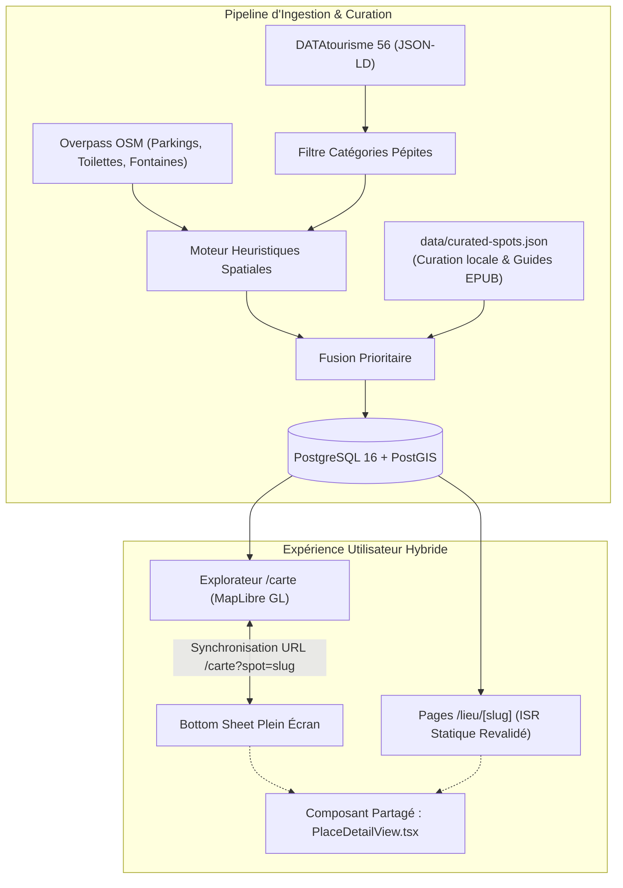

# Spécification Technique & Fonctionnelle (Design Spec)
## Chantier 1 : Fiches Descriptives Riches, Ingestion DATAtourisme & Curation de Contenu

> **Date :** 2026-10-22  
> **Statut :** Validé en Brainstorming  
> **Périmètre :** Super-App Guide Morbihan — Chantier 1 (Socle Découverte & Fiches Lieux)  
> **Cible UX :** Mobile-First (PWA Web App) avec support Desktop  

---

## 1. Contexte & Objectifs Produit

Suite aux retours sur la version initiale (Blocs 1 à 5), l'application évolue vers une **super-app territoriale intelligente** dédiée au Morbihan. L'objectif est d'éviter le piège de la multiplicité d'applications fragmentées (AllTrails pour le GPX, Google Maps pour les avis, PDF d'offices de tourisme pour les horaires de marée) tout en conservant une fluidité extrême et sans coût d'infrastructure externe.

Ce **Chantier 1** pose la brique essentielle de **découverte de contenu** :
1. **Richesse éditoriale et pratique** : Chaque lieu dispose d'une fiche complète (galerie photos, description soignée, conseils d'initiés, temps de visite estimé, tarif, accessibilité poussette/animaux, guidage GPS immédiat vers le bon parking).
2. **Contexte intelligent et adapté** : Les badges d'état (marée, vent, pluie) ne sont affichés que s'ils sont pertinents pour la typologie du lieu (marée pour les plages et passages submersibles, repli météo pour les musées/châteaux, coucher de soleil pour les panoramas, terrasse pour les huîtres).
3. **Ingestion open-data sélective & curation locale** : Alimentation de 200 à 400 spots remarquables du Morbihan via le flux officiel DATAtourisme (Flux 56) et OpenStreetMap, couplée à un fichier de surcharges souveraines pour les 50 spots majeurs et l'exploitation future de guides de référence (fichiers EPUB du Routard / Hachette).
4. **Expérience hybride fluide** : Sur la carte (`/carte`), la fiche s'ouvre dans un volet gestuel plein écran sans rechargement de page, tout en disposant de sa propre URL indexable et partageable (`/lieu/[slug]`).

---

## 2. Architecture Globale & Découpage



---

## 3. Schéma de Données Étendu (Drizzle ORM)

La table existante `places` dans [`src/db/schema.ts`](file:///Users/Moulitos/Documents/antigravity/Guide%20Morbihan/src/db/schema.ts) est enrichie des types et colonnes suivants :

### A. Nouveaux Types TypeScript

```typescript
export interface PhotoItem {
  url: string;
  caption?: string;
  credit?: string;
  isCover?: boolean;
}

export interface PracticalInfo {
  recommendedDurationMinutes?: number; // Ex: 45, 90, 180
  pricing?: string;                     // Ex: "GRATUIT", "Adulte 9€, Enfant 5€"
  amenities?: ('toilets' | 'water' | 'parking' | 'food' | 'picnic_table' | 'shade')[];
  insiderTip?: string;                  // Conseil d'initié (Routard / Curation)
  goodToKnow?: string;                  // Info pratique essentielle
  bestSeason?: ('SPRING' | 'SUMMER' | 'AUTUMN' | 'WINTER')[];
}

export interface TideDetails {
  highTideAdvantage?: string;           // Ex: "Baignade optimale, eau translucide"
  lowTideAdvantage?: string;            // Ex: "Estran rocheux idéal pour la pêche aux coques"
  warningNote?: string;                 // Ex: "Submersion totale de la chaussée"
}
```

### B. Colonnes Complémentaires de la Table `places`

* `photoGallery` : `jsonb('photo_gallery').$type<PhotoItem[]>().default([])`
* `practicalInfo` : `jsonb('practical_info').$type<PracticalInfo>()`
* `tideDetails` : `jsonb('tide_details').$type<TideDetails>()`
* `sourceType` : `varchar('source_type', { length: 50 }).default('CURATED')` (`'DATATOURISME'`, `'CURATED'`, `'MANUAL'`)

---

## 4. Pipeline d'Ingestion & Curation Hybride

### A. Connecteur DATAtourisme Sélectif (`src/lib/ingest/datatourisme-connector.ts`)
* **Source :** Téléchargement du dump officiel JSON-LD du Morbihan (flux départemental 56).
* **Filtres positifs :**
  * `NaturalHeritage` (plages, criques, réserves, étangs, pointes littorales)
  * `CulturalHeritage` (mégalithes, alignements, cairns, châteaux, remparts, ports historiques)
  * `Viewpoint` (panoramas, promontoires, tables d'orientation)
  * `TastingProvider` / `LocalProduce` (chantiers ostréicoles, conserveries, criées)
* **Filtres négatifs (Rejet strict) :**
  * Hébergements (hôtels, campings, gîtes, chambres d'hôtes)
  * Services génériques (distributeurs, parkings relais isolés, bureaux administratifs)

### B. Moteur d'Heuristiques Spatiales
1. **Marégraphe d'ancrage :**
   * Coordonnées au nord/est du goulet de Port-Navalo (`longitude > -2.85` et `latitude > 47.55`) $\rightarrow$ Marégraphe de **Vannes**.
   * Coordonnées vers l'océan ou la presqu'île de Rhuys/Quiberon $\rightarrow$ Marégraphe de **Port-Navalo**.
2. **Exposition au vent des plages :**
   * Calcul géométrique du vecteur ouvrant vers la nappe marine la plus proche pour classifier l'abri thermique (`shelteredFromWindDirections`).
3. **Association de proximité OSM :**
   * Requête Overpass ciblée sur les nœuds `amenity=parking`, `amenity=toilets`, `amenity=drinking_water` situés à moins de 300 mètres du spot.

### C. Fichier de Curation Souveraine (`data/curated-spots.json`)
* Fichier versionné dans le dépôt contenant les fiches qualitatives des 50 pépites incontournables.
* Lors de l'exécution du script `npm run db:ingest`, les fiches du fichier local écrasent prioritairement les données brutes DATAtourisme (garantissant des photos HD choisies, des textes engageants et les heures de passage de Berder/Tascon).
* Emplacement prévu pour l'injection des futurs extraits de guides touristiques EPUB : `data/guides/`.

---

## 5. Architecture UX/UI des Fiches Détaillées

### A. Composant Cœur Partagé : `PlaceDetailView.tsx`
Utilisé à la fois sur la page autonome et dans le panneau coulissant de la carte :
1. **En-tête intelligent et adapté à la catégorie :**
   * *Plage / Crique :* Statut de baignade en fonction de la marée actuelle + abri du vent.
   * *Passage submersible :* Compte à rebours temps réel de praticabilité.
   * *Patrimoine / Musée :* Badge *"Idéal s'il pleut"* ou *"Durée conseillée : 1h30"*.
   * *Panorama :* Heure dorée et coucher de soleil.
   * *Lieu sans contrainte :* Présentation épurée sans badge forcé.
2. **Galerie médias :** Défilement horizontal fluide avec indicateur de position et crédits photographiques discrets.
3. **Conseil d'initié (L'Avis de la rédaction) :** Encadré distinctif mettant en valeur les tips de terrain.
4. **Logistique de stationnement (Call-to-Action 1-clic) :**
   * Affichage clair du parking conseillé (gratuit/payant, distance à pied du site).
   * Bouton direct ouvrant au choix : **Waze**, **Google Maps** ou **Apple Plans**.
5. **Barre d'action fixe sur mobile :**
   * Bouton principal *"Y aller (GPS Parking)"*.
   * Bouton secondaire *"Ajouter à mes favoris"*.
   * Bouton *"Localiser sur la carte"*.

### B. Interaction Carte & Synchronisation d'URL
* Sur `/carte`, le clic sur un marqueur ou une carte de la bottom sheet étire la bottom sheet à 90% (plein écran) et déclenche un `history.pushState` vers `/carte?spot=[slug]`.
* L'utilisateur peut refermer la fiche par un geste tactile vers le bas ou en appuyant sur la touche Retour du téléphone, revenant immédiatement à la carte sans rechargement.
* Le bouton *"Partager la fiche"* copie l'URL universelle `https://domain.com/lieu/[slug]`.

---

## 6. Performance, SEO & Résilience

1. **Rendu ISR (Incremental Static Regeneration) :**  
   Les pages `/lieu/[slug]` sont pré-générées à la compilation et revalidées sur demande ou toutes les 24 heures (`revalidate = 86400`).
2. **Hydratation contextuelle légère :**  
   Les données de marées et météo dynamiques sont injectées côté client par une requête ultra-légère vers `/api/context/live` pour ne jamais bloquer le TTFB (Time to First Byte).
3. **Balisage structuré JSON-LD :**  
   Génération automatique des balises `TouristAttraction` et `FAQPage` pour l'indexation Google.
4. **Images résilientes :**  
   Gestion des fallbacks d'images locales si une URL distante DATAtourisme est brisée.

---

## 7. Plan de Tests & Vérification

| Test | Cible | Critère de succès |
|---|---|---|
| **Test Filtre Ingestion** | `datatourisme-connector.test.ts` | 100% des hôtels/campings rejetés, 100% des plages et sites majeurs acceptés. |
| **Test Heuristique Contexte** | `place-context.test.ts` | Un lieu patrimonial n'affiche jamais d'alerte marée ; une plage affiche l'état d'eau exact. |
| **Test Navigation Hybride** | `MobileExplorerSheet.test.tsx` | La sélection d'un lieu modifie l'URL sans rechargement et affiche les détails complets. |
| **Test Compilation & Types** | `npm run build` | Zéro erreur TypeScript, génération réussie des pages statiques `/lieu/[slug]`. |
